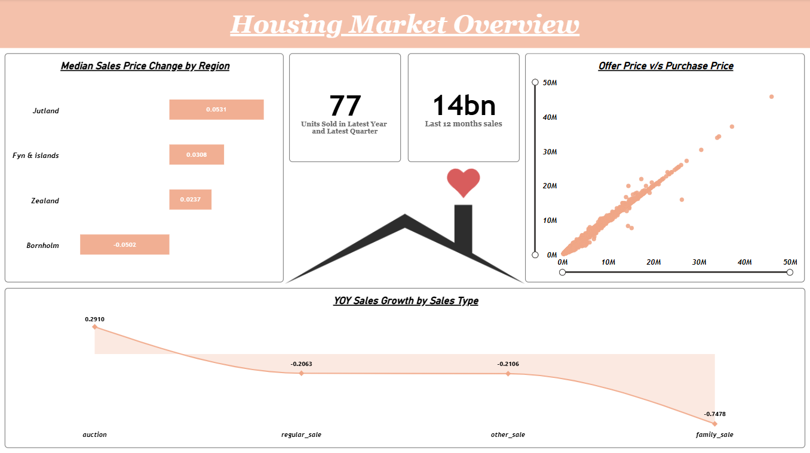
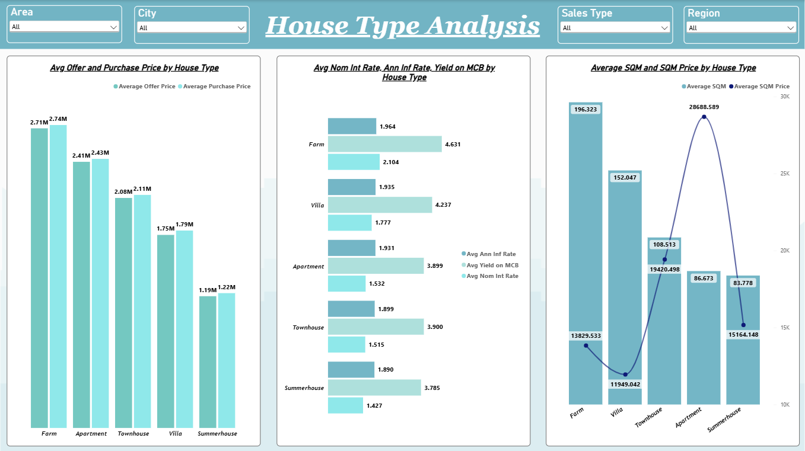

# Housing Market Analytics

An end-to-end business intelligence project exploring Denmark's
residential property market using **Google BigQuery** as the cloud data
source and **Microsoft Power BI** for data modeling, KPI development,
and interactive reporting.

The report is organized into three analytical pages: **Housing Market
Overview**, **Sales Performance Analysis**, and **House Type Analysis**.
Together, they examine regional sales value, offer-versus-purchase
pricing, sales-type growth, housing-type price differences, and
mortgage/economic indicators.

> **Project focus:** Turn a large property transaction dataset into a
> navigable report that helps stakeholders compare regions, understand
> property-type economics, and spot patterns in sales channels and
> pricing.

## Dashboard Preview

### 1. Housing Market Overview



### 2. Sales Performance Analysis


### 3. House Type Analysis



## Project Objectives

-   Compare total and typical property prices across Danish regions.
-   Assess the relationship between offer prices and purchase prices.
-   Monitor sales performance and year-over-year (YoY) growth by sales
    type.
-   Compare offer price, purchase price, floor area, and price per
    square metre across house types.
-   Explore how nominal interest rates, annual inflation, and
    mortgage-credit-bond yields vary alongside property-market measures.
-   Provide filters for **Area, City, Sales Type, and Region** so users
    can investigate market segments rather than relying only on
    national-level totals.

## Technology Stack

  -----------------------------------------------------------------------
| Tool               | Role in the Project                                                                          |
| ------------------ | -------------------------------------------------------------------------------------------- |
| Google BigQuery    | Cloud data source for SQL-based exploration, table creation, and date-field transformation.  |
| Microsoft Power BI | Data modeling, DAX measures, interactive visualizations, slicers, and dashboard development. |
| SQL                | Querying, validating, copying, and transforming the housing dataset.                         |
| CSV                | Source data used for data inspection, profiling, and analysis.                               |
| Excel              | Column definitions and data dictionary documentation.                                        |

## Dataset

The supplied `Housing Data.csv` contains **100,000 rows and 19
columns**. It represents property transactions/listings in Denmark, with
transaction dates and property, location, price, and economic fields.
The available dates span approximately **1992-2024** based on the
quarter field.

### Data dictionary

  ---------------------------------------------------------------------------
| Column | Meaning |
|---|---|
| `date` | Date associated with the transaction/record |
| `quarter` | Year-quarter label (e.g., `2024Q4`) |
| `house_id` | Property identifier |
| `house_type` | Property category: Farm, Villa, Apartment, Townhouse, or Summerhouse |
| `sales_type` | Transaction category: regular sale, family sale, other sale, or auction |
| `year_build` | Year the property was built |
| `purchase_price` | Recorded purchase price |
| `%_change_between_offer_and_purchase` | Percentage change between offer and purchase price |
| `no_rooms` | Number of rooms |
| `sqm` | Property area in square metres |
| `sqm_price` | Price per square metre |
| `address` | Property street address |
| `zip_code` | Postal code |
| `city` | City/locality |
| `area` | Subregional area/district grouping |
| `region` | Broad region grouping: Jutland, Zealand, Fyn & islands, or Bornholm |
| `nom_interest_rate%` | Nominal interest rate, expressed as a percentage |
| `dk_ann_infl_rate%` | Denmark annual inflation rate, expressed as a percentage |
| `yield_on_mortgage_credit_bonds%` | Mortgage-credit-bond yield, expressed as a percentage |

## Dashboard Pages and KPIs

### 1. Housing Market Overview

This page provides a high-level snapshot of regional pricing, recent
sales activity, the offer-to-purchase relationship, and sales growth by
transaction type.

**Visuals:** 
- Horizontal bar chart: median offer-to-purchase change by
region. 
- KPI cards: recent units sold and trailing 12-month sales. 
- Scatter plot: offer price versus purchase price. 
- Area/line chart: YoY
sales growth by sales type.

**Insights:** 
- **Regional price
negotiation differs:** Jutland, Fyn & islands, and Zealand show positive
median offer-to-purchase changes in the visual, while Bornholm is
negative. This suggests the gap between offer and final purchase price
is not uniform across regions. 
- **Offer and purchase prices move closely together:** The
scatter plot shows a strong positive relationship overall, with a small
number of high-value outliers. These properties merit drill-through
checks so premium transactions do not obscure patterns among typical
homes. 
- **Growth is uneven across sales types:** The displayed YoY
measure is positive for auctions (about `0.291`) and negative for
regular sales (about `-0.206`), other sales (about `-0.211`), and family
sales (about `-0.748`). The sharp negative family-sale result should be
investigated against the selected year, prior-year baseline, and
transaction volumes before being treated as a broad market signal.

### 2. Sales Performance Analysis

This page compares the regional distribution of sales value, explains
purchase-price variation, and provides a transaction-level time-oriented
table.

**Visuals:** 
- Sales by Region: regional sales value,
shown as a horizontal bar chart. 
- Key Influencers: explores which fields are associated with higher or lower purchase prices. 
- Year/Quarter/Month/Day table: displays time fields with Total YTD
Sales and Total Purchase Price. 
- Offer Price to SQM Ratio by Sales
Type: compares the offer-price-per-area measure across transaction
types. 
- Average SQM Price by Region: compares regional average
price per square metre.

**Insights:** 
- **Zealand has the
largest aggregate purchase value in this extract:** approximately
`94.97bn`, versus `81.48bn` for Jutland, `14.92bn` for Fyn & islands,
and `1.24bn` for Bornholm. These are totals across the available
records, not necessarily current-period market shares. 
- **Jutland has
the highest transaction count:** 49,937 records, compared with 39,740
for Zealand. Zealand's higher aggregate value despite fewer records is
consistent with a higher average transaction price. 
- **Average recorded purchase price differs by region:** Zealand is
approximately `2.39m`, Jutland `1.63m`, Fyn & islands `1.61m`, and
Bornholm `1.17m`. 
- **Price per square metre is highest in Zealand:**
about `20.85K` in the supplied extract, followed by Fyn & islands
(`13.62K`), Jutland (`13.51K`), and Bornholm (`10.60K`). This highlights
meaningful geographic variation in the price of space. 

### 3. House Type Analysis

This page allows users to filter by area, city, sales type, and region,
and compare property categories.

**Visuals** 
- Average offer price versus average purchase price by house
type. 
- Average nominal interest rate, inflation rate, and
mortgage-credit-bond yield by house type. 
- Average square metres versus
average price per square metre by house type.

**Insights:** 
- **Apartments have the highest
average price per square metre** at approximately `28.69K`, despite a
smaller average area (`86.7 sqm`). This points to a substantially higher
price per unit of space than larger property categories. 
- **Farms have
the largest average floor area** at about `196.3 sqm`, with an average
price per square metre of approximately `13.83K`. 
- **Villas dominate
the dataset by volume:** 54,214 records, or about 54% of the extract.
Their average area is approximately `152.1 sqm`, and their average price
per square metre is about `11.95K`. 
- **Farms have the highest average
recorded purchase price** at about `2.74m`, followed by apartments
(`2.43m`), townhouses (`2.11m`), villas (`1.79m`), and summerhouses
(`1.22m`). 
- **Summerhouses have the lowest average recorded purchase
price** at about `1.22m`; their average area is approximately
`83.8 sqm`. 

## BigQuery and SQL Work

The `housing_data.sql` records the BigQuery exploration and
preparation steps:

- Previewing the source table with a row limit.
- Creating a test copy for exploratory analysis.
- Aggregating average purchase price by `sales_type`.
- Testing a conditional update on square-metre values for records with three rooms.
- Reformatting the `date` field.
- Creating a working `Housing` table from the prepared data.

## Repository Structure

``` text
housing-market-analytics/
├── Housing Data.csv             
├── column_definations.xlsx     
├── housing_data.sql              
├── housing_analysis.pbix         
├── README.md
└── screenshots/
    ├── housing-market-overview.png
    ├── sales-performance-analysis.png
    └── house-type-analysis.png
```

## Business Value

This dashboard helps a stakeholder: 
- Compare regional market value with
typical price levels, rather than judging regions from transaction
counts alone. 
- Identify property types with higher price per square
metre and distinguish price-per-space from total property price. 
- Monitor whether recent sales activity and YoY performance differ by
sales channel. 
- Investigate outliers in offer-versus-purchase
pricing. 
- Explore possible relationships between property attributes
and price while keeping the analysis interactive through geographic and sales-type filters.
